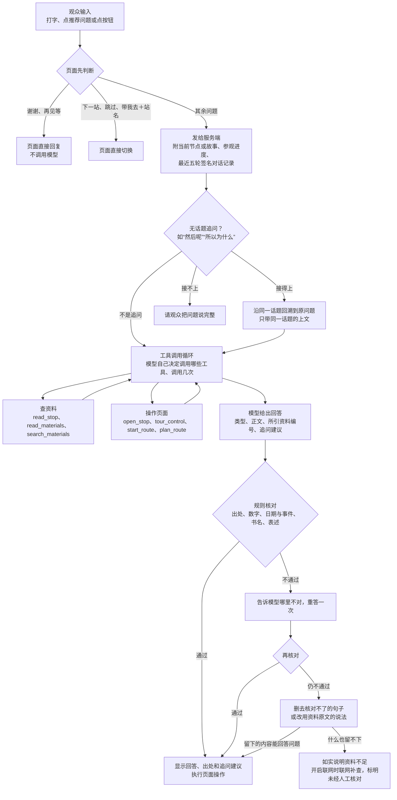
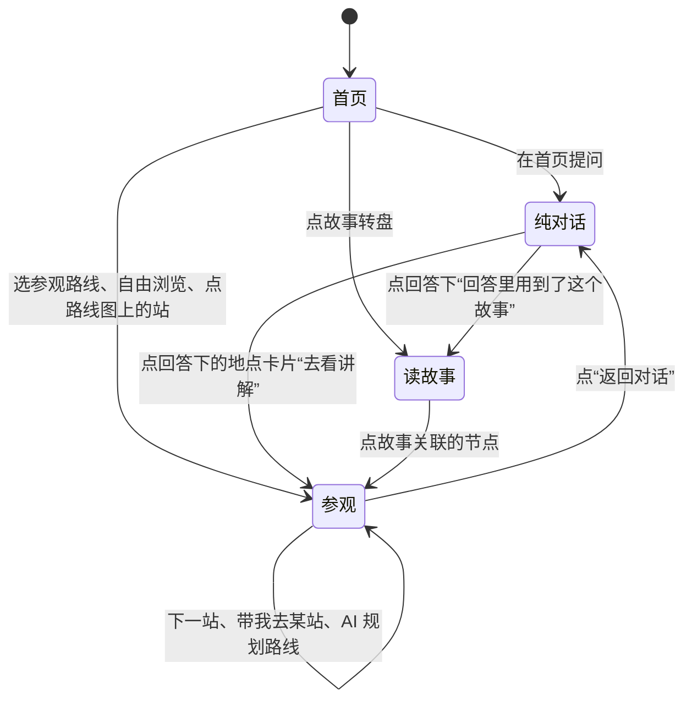

# 《长征路上》创作文档说明

> 参赛赛道：赛道三 · AI Agent
> 作品名称：长征路上 · AI 讲解员“小征”
> 作者／团队：【待填写】　　指导老师：【待填写】
> 访问链接：【待填写】　　站点版本：Sites v71（对应 main `4c1a1c2`，代码与 `4e58b23` 相同）　　文档对应代码版本：`4e58b23`（GitHub `Seren-715/long-march-guide`）

## 一、作品概况

《长征路上》是一个以长征为主题的网页 AI 智能体，目的是让普通观众了解长征、传播红色文化。首页大标题是“万水千山，从一个故事说起”，定位语是“真人真事，皆有出处”。

智能体“小征”先讲故事，再通过分段阅读、关联节点和“继续前行”，把观众引向背后的历史。观众可以随时提问，也可以贴一句听来的说法让小征核对。小征查阅有出处的史料后作答并附出处，资料里没有的直接说明；联网补查的内容单独标注。

收录范围是中央红军（红一方面军）主力的长征路线：从中央苏区到吴起镇共 23 处，另有直罗镇和红军三大主力会师（会宁、将台堡），共 26 个历史节点，配有 37 个有出处的长征故事。

作品同时覆盖赛道列举的三类智能体：

- **虚拟长征讲解员**：按路线逐站讲解，衔接前后站，支持整站朗读和选中讲解或对话中的文字后朗读。
- **智能问答助手**：针对当前节点和整段长征回答问题，标明依据、附出处，资料没有的明确说不知道。
- **任务规划 Agent**：根据观众一句话的参观偏好，从 26 个节点中规划 3 站路线；对话中也能听懂“带我去泸定桥”“下一站”等指令并执行。

## 二、Agent 设定

| 项目 | 设定 |
| --- | --- |
| 身份 | 长征故事讲述与史料查证助手“小征”，面向自主学习的学生和参观者；资料范围是中央红军主力的长征路线 |
| 形象 | 朱红色“征”字方印，与作品标识统一。不使用任何真实人物或他人版权角色形象 |
| 语气 | 亲切、简洁、庄重；常用“我们来到……”，回答一般不超过 300 字，讲完一站后以问题或按钮引导下一步 |
| 能力 | 逐站讲解与衔接；**自己决定查哪些资料**（按节点查阅、按编号查阅、关键词检索，可多步）；依据资料回答并附出处；回答前自查出处、数字和文件名，不合格就重答；理解指代的多轮对话（同一节点、同一故事内最近五轮；“具体点呢”“所以为什么”这类没说主题的追问，沿同一话题回溯到原问题，问候、闲聊插在中间不算话题，接不上就请观众说完整）；执行页面操作（前往节点、下一站、跳过、开始预设路线、按兴趣和时间定制路线）；给出可点击的追问建议。处理过程在对话中逐步显示 |
| 边界 | 馆内回答依据本次查阅的项目资料；资料只支持部分问题时，说明具体缺口。联网补查单独显示，并标注“网络来源 · 未经人工核对”。不扮演历史人物、不编造对话或细节；与长征无关的问题礼貌引导回主题；出处由系统统一展示 |
| 感知的上下文 | 当前所在节点和故事；所选路线、当前第几站、已看过哪些站；同一会话、节点和故事范围内最近五轮经签名校验的问答 |

## 三、交互逻辑

### 0. 交互总览

下图是观众说一句话之后，页面、服务端和模型各做什么。实线框里的每一步，都会以“处理过程”的形式实时显示在回答上方（例如“查阅「泸定桥」的资料 · 7 条 → 核对未通过，重新作答 · 数字 30人 不在资料中 → 引用与数字规则检查 · 规则检查通过（非史实核验）”），观众能看到小征查了什么、为什么重答。

观众在三种状态之间切换，小征知道自己处在哪种状态，带的上下文也不同：

| 状态 | 小征知道什么 | 典型交互 |
| --- | --- | --- |
| 纯对话（首页直接提问） | 不绑定节点；用工具在全部资料里找 | 问答、查证说法、讲故事；回答下给出相关地点和故事入口 |
| 参观（对话＋讲解两栏） | 当前节点、所选路线、第几站、已看过哪些站 | 逐站讲解、“下一站”、“我想看看飞夺泸定桥那段”、按兴趣定制路线 |
| 读故事 | 正在读的故事及它用到的资料 | “后来呢”“这个故事是真的吗”等围绕故事的追问 |

### 1. 进入与引导

首页配色为红白两色，观众第一步不必打字：

1. **故事转盘**：37 个有出处的长征故事，拖动或点击翻看，点开后分段阅读。
2. **四个入口**：
   - **目录**：按专题、分类找故事，也能看到自己读过的故事、看过的站、问过的问题，可以接着上次参观。
   - **自由浏览**：按时间浏览全部 26 个节点；对话侧栏可进入路线选择，包括推荐路线和 AI 规划。
   - **人物档案**：24 位人物的长征时期简介，详情展示相关故事、出处、节点跳转和可用提问。节点是讲解分类，不表示故事都发生在节点地点。
   - **八闽儿女的长征**：福建专题，阅读故事、出处和口径提示，并跳转至关联节点。
3. **提问框**：可以直接提问。下方有“试试”示例问题（可换一批）和“核对一句话”：选一句常见说法，让小征对着资料核对。
4. **主力长征路线动画**：从中央苏区、于都到吴起镇共 23 处，定位标按顺序落下，虚线随之延伸，同步显示日期和名称（按各处的大致经纬度摆放，不用底图）；点任意一处即进入这一站的讲解。

### 2. 逐站参观

进入后页面分为两栏：左侧是与小征的对话，右侧是当前节点的讲解（手机上用“讲解／对话”切换）。

- 讲解区顶部是一块可收起的**沙盘鸟瞰图**：用 Blender 建模渲染的长征途经地区地形示意，西部横断山脉高耸、金沙江与大渡河切出深谷、夹金山积雪、草地遍布沼泽，北面是黄土高原，直观呈现路途的凶险。节点是可点击的标记，当前站高亮、看过的站变色，点击即切换到该站的讲解；站与站之间的虚线只表示先后顺序，不是行军路线。
- 每站顶部显示日期印章、地名和“中央红军出发后约 N 个月”，让观众感受时间推移。
- 正文包括本站概述、原文出处、延伸资料，以及“关于这一站可以问”的推荐问题。
- 每站讲解结束时，小征给出快捷按钮：「下一站：××」「再讲讲这一站」。点“下一站”时，小征说明从哪一站来到哪一站、这是路线第几站、还剩几站，而不是复读正文。
- 走完路线后，小征回顾走过的各站，并可复制或下载参观小结。
- 节点条支持方向键切换；地址栏同步当前节点，可刷新、后退或分享链接。
- 可开启“语音讲解”，切站时由浏览器朗读本站内容。

### 3. 长征故事

- 首页故事转盘提供 37 个有来源的故事，包括半条被子、陈树湘、贺子珍、苟坝会议的马灯、张思德等；详见《知识库说明》。
- 故事分段阅读，点“接着往下看”逐段展开；读完依次出现出处、“在这里问小征”（围绕这个故事的推荐问题）和“继续前行”（下一篇故事）。
- 讲解区以“长征故事”卡片展示，附原文出处；情节惨烈或容易混淆（如红四方面军、红二六军团的故事）的，卡片上有讲解提示。
- 每站的快捷按钮里有“听小征讲个故事”：小征直接讲出故事原文并附出处，不调用模型；观众也可以用对话请小征讲故事，模型只能依据故事资料讲述，不得添加情节、对话或心理描写。
- 故事来自有出处的报道或党史叙述，标注所用来源。

### 4. 返回对话

自由对话中进入沙盘、路线或人物讲解后，可通过顶部“返回对话”回到原对话；保留本页面会话内的消息、输入草稿和已保存的对话上下文。

### 5. 问答

1. 观众提问，或点击推荐问题、追问建议。
2. 页面把问题、当前节点、参观进度（节点 ID）和最近的对话凭证发给服务端。
3. 服务端把小征作为**工具调用智能体**运行：模型手里只有资料目录（每条资料的编号和开头几个字）和当前节点的资料，其余要自己调用工具去取，可以连续调用多步：
   - 查资料：`read_stop`（按节点查阅）、`read_materials`（按编号查阅）、`search_materials`（关键词检索）。
   - 操作页面：`open_stop`（打开某一站）、`tour_control`（下一站、跳过）、`start_route`（预设路线）、`plan_route`（按兴趣和时间定制路线）。
4. 模型给出最终回答时先判断问题类型：
   - **历史问题**：只依据本次取出的资料作答，并列出依据的资料编号；没取出的资料不能引用。
   - **问候或使用说明**：简短回应，不陈述史实。
   - **无关问题**：礼貌引导回长征主题。
5. 服务端校验回答（见“五、技术架构”）。发现越界数字、日期或名称时，会要求模型重答；仍有问题时，尽量保留经规则检查且能独立回答问题的句子，说明未核对的部分。
6. 整个过程实时显示在对话里，例如“查阅「遵义」的资料 · 3 条 → 引用与数字规则检查 · 引用 3 条 · 规则检查通过（非史实核验）”。回答出现后，这几行保留在回答上方。
7. 页面显示回答，标明“提问时的节点”；如果有页面操作（例如前往泸定桥、开始定制路线），随即执行。每次回答只执行一个页面操作。

**从首页直接提问**时进入“纯对话”模式：只显示居中的对话栏，不展开讲解栏，也不把问题绑定到某个节点（服务端提示词说明“观众在首页直接提问”）。回答正文下方会根据引用资料给出醒目的地点卡片（沙盘缩略图、地点名与日期、“去看讲解 →”按钮），观众想看讲解时再切换到“对话 + 讲解”双栏，避免一提问就跳到一个无关节点。宽屏下对话左侧还有一列功能小卡片：换种方式探索（参观路线、沙盘浏览、人物档案）、可以这样问我（可换一批）、对话中提到的地点，方便观众从对话自然转入其他玩法。

### 6. AI 路线规划

观众用一句话描述想看什么（例如“我想看翻雪山、过草地那一段”），模型从 26 个节点中选出 3 个。服务端校验节点合法、数量正确后按时间排序，并根据实际选中的节点生成说明。与长征学习无关的偏好会被拒绝。选择“完整路线”时由系统直接按时间顺序返回全部节点，不调用模型。

### 7. 连续追问与联网补查

- **追问接话题**：“具体点呢”“然后呢”“所以为什么”这类没说主题的话，服务端沿签名对话记录回溯到同一话题的原问题，只把这一话题的上文交给模型。中间插的问候、闲聊不算话题。换了话题，旧话题不再带上。
- **接不上就问**：没有可接的上文时，不让模型去猜，直接请观众把问题说完整，并给出示例。
- **联网补查**：每个有出处的历史回答下方都有“想了解更多？试试联网搜索”。点它，会带着这一轮的原话和发问前的对话记录去搜，所以“后来呢？”搜到的是原话题的后续，而不是一个孤立的“后来呢”。在输入框里只说“联网搜索”，搜的是最近一个实质问题。网络结果单独列出来源，并标明“网络来源 · 未经人工核对”。

### 8. 三个真实处理过程

以下摘自 `docs/比赛测试记录/附录A-探索测试问答.md`（代码版本 `87f3e98`）。“处理过程”是页面上实际显示的文字。

**查证一个错误数字（C2）**
- 问：听说飞夺泸定桥的突击队有30人，对吗？
- 处理过程：查阅「泸定桥」的资料（7 条）→ 核对未通过，重新作答（数字 30人 不在资料中）→ 删去未能核对的内容（1 句）→ 引用与数字规则检查（引用 3 条 · 规则检查通过）
- 答：资料记载的不是30人。1935年5月29日夺泸定桥时，红四团二连的22名共产党员和积极分子组成突击队，由连长廖大珠任队长……
- 看点：首稿复述了提问里的“30人”，被数字核对拦下；重答后先纠正，再给出资料里的说法。

**两稿都没过时改用资料原文（X1）**
- 问：湘江战役之后中央红军还剩多少人？
- 处理过程：查阅「于都」「湘江」的资料（3 条）→ 核对未通过，重新作答（表述超出资料）→ 改用资料原文说明兵力变化 → 引用与数字规则检查（引用 1 条 · 规则检查通过）
- 答：从长征出发时到渡过湘江后，中央红军兵力由8.6万余人减至3万余人。这是这一整段的兵力变化，不能当作湘江单场战役的伤亡人数。
- 看点：模型两次都把累计兵力变化说得像单场战役的损失；服务端拦下后改用资料原文的说法作答。

**连续追问中插入闲聊（E1）**
- 问 1：遵义会议有什么意义？→ 查阅「遵义」的资料（3 条），作答。
- 问 2：具体点呢 → 接回“遵义会议有什么意义”，查阅「遵义」的资料（5 条），从会议本身、做了什么、意义三方面展开。
- 问 3：你是谁？→ 闲聊，简短自我介绍，不引用资料。
- 问 4：然后呢 → 跳过“你是谁”，仍接遵义会议。处理过程：核对出处：引用的资料尚未查阅，先去查资料 → 查阅「遵义」的资料（3 条）→ 引用与数字规则检查。答：遵义会议之后，红军二渡赤水、再占遵义，娄山关战斗是长征以来第一个大胜仗；会上张闻天作“反报告”……
- 看点：闲聊不打断话题；模型想引用还没取出的资料时被提醒“先去查资料”，取出后才作答。

## 四、应用场景

- **课堂教学**：教师在课堂上按路线带领学生逐站讲解，学生课后自行提问复习。
- **自主学习**：学生或公众按兴趣选择路线，边看边问，每个回答都能追溯到原文。
- **研学与纪念馆导览**：手机打开即用，开启语音讲解后可作为随身导览。
- **主题教育活动**：参观结束后导出小结，用于学习记录或交流分享。

## 五、技术架构

### 1. 组成

| 部分 | 说明 |
| --- | --- |
| 前端页面 `src/page.html` | 原生 HTML、CSS、JavaScript，无框架依赖；负责首页、路线、节点条、讲解、对话、语音讲解；采用红白浅色配色并支持手机布局 |
| 服务端 `src/server.js` | Worker 形式的 JavaScript 服务，提供页面、`/api/chat`（问答）和 `/api/plan`（路线规划）；负责提示词组织、工具调用循环（模型调用工具 → 服务端执行 → 结果交还模型）、输出校验、对话签名和限流；问答支持逐行流式返回处理步骤 |
| 知识库 `src/data.js` | 26 个节点和 120 条扩展资料，共 146 条节点资料，每条都有原文标题和链接，随代码一同发布 |
| 长征故事 `src/stories.js` | 长征故事，标注资料依据和审核状态；已审核的故事也进入问答资料 |
| 沙盘 `scripts/map/build_map.py` | 用 Blender（Python 模块 bpy）程序化建模：按示意塑造山脉、峡谷、雪峰、沼泽、黄土沟壑，以低角度斜阳渲染鸟瞰图（WebP，约 70 KB），同时算出节点、示意虚线和地名在图上的位置（`src/map-layout.json`）。只做方形沙盘，不画任何边界，不标行政区，标注“地形示意，非精确地图” |
| 构建 `scripts/generate.mjs` | 把页面、知识库和服务端代码合成为部署入口 `worker/index.js`，并在构建时填入节点数和史料数 |

### 2. 一次问答的处理流程

1. **请求检查**：校验请求格式、大小（不超过 24 KB）、来源和会话编号。
2. **限流**：每个 IP 每 10 分钟最多问答 30 次、规划 10 次，每个服务实例每小时调用模型不超过 600 次。
3. **还原对话上下文**：最近五轮问答以服务端签名的凭证保存在页面，服务端验签后才使用。凭证同时绑定会话、节点和当前故事，记录回答类型和所接的话题，一小时后失效。历史对话只用于理解指代，引用过的馆内资料仍须从资料库取出核对。
4. **组织提示词**：包括小征的角色设定、问题分类和页面操作规则、当前节点与参观进度、资料目录，以及可预载的馆内资料。预载范围取决于节点、在读故事、签名历史及需要指定材料的查证题。没有预载的资料可通过工具取得。
5. **工具调用循环**：模型可以调用 7 个工具（3 个查资料、4 个操作页面）。服务端执行工具、记录已取出的资料编号和处理步骤，把结果交还模型，直到模型给出 JSON 格式的最终回答 `{type, answer, sources, followups}`。单次问答最多 7 轮模型调用、约 8 次工具调用，超时 45 秒。
6. **校验输出**：
   - 资料编号必须在白名单内，并且**必须是本次问答中已经取出的资料**；引用了没取出的资料时，提醒模型先去查（一次）。历史回答没有有效出处时，降级为“资料不足”。
   - **数字核对**：根据引用资料检查数量及精度，检查日期与其所述事件是否对应。回答若明确否定或标记无法核实，可复述用户给出的数字；肯定陈述仍须有资料依据。
   - **日期核对**：日期要对上它修饰的那件事。例如四渡赤水每一次各有日期，不能互借；区间的起止须来自同一段记述；只写“17日”的，接上一句的年月。
   - **名称核对**：书名号中的文件、文章名必须与所引资料一字不差。
   - **外站说法**：回答里连续 7 个字以上的说法，如果只见于另一站、又没有引用的资料里，多半是把别处的事说到了这里（例如把黎平会议的决定说成遵义会议的），要求重答或删去这一句。
   - **定向规则**：资料没写的说法，不能断言“没有这回事”；湘江战役前后的兵力变化，不能写成单场战役的损失；观众用的称呼资料里没有时，先说明。
   - 数字或名称不符时，带着提示让模型重写。若仍有部分内容未通过，则保留能独立回答问题的合格句子；没有可保留的内容时，说明未核对的事项并引导重新提问。
   - 闲聊、无关类型的回答不附出处，因此其中陈述史实的句子会被删除，只保留引导句；自称闲聊却带年份的回复按历史问题处理。
   - 删除网址，以及谈论“链接”的句子。
   - 页面操作只接受存在的节点和预设路线；定制路线限 2—6 个节点并按时间排序；一次回答只执行第一个操作。
   - 追问建议过滤长度、网址和重复项。
   - 输出被截断或格式错误时，提示模型格式不对、重试一次。模型只回一串空格时（DeepSeek JSON 模式偶发），也明确提示它重写。路线或页面操作已经完成，只是说明文字格式不对时，用一句固定说明代替，不让整个请求报错。
7. **返回结果**：出处按原文链接合并，保留该来源下所用的全部证据条目，附上依据摘要并签发新的对话凭证。启用联网时，馆内资料不足的历史题可尝试联网，读者也可以主动补查。网络结果单列来源和核对状态，后续馆内问答不把网络正文作为史实证据。

### 3. 使用的 AI 平台与框架

| 项目 | 内容 |
| --- | --- |
| 大模型 | DeepSeek 开放平台 Chat Completions 接口，模型 `deepseek-chat`；JSON 输出模式并启用函数调用（tools），温度 0.2；问答每轮最多输出 900 个 token，规划最多 350 个 token；一次问答超时 45 秒，路线规划超时 25 秒 |
| Agent 编排 | 自行实现：工具定义与多步调用循环、提示词约束与结构化输出、服务端校验与重试、页面操作执行、参观上下文管理、处理步骤流式返回（NDJSON） |
| 检索方式 | 智能体式检索增强生成（Agentic RAG）：模型按节点、编号或关键词调用工具取资料，取到的资料才能引用。关键词检索使用字符二元组 BM25，配合同义说法和拆字查询，返回前 8 条；资料目录在每条开头 26 字之外补上人数，帮助模型判断该取哪条。资料共 185 条、约 2.8 万字，专名要求精确匹配。离线检索评估 46 条，前 3 条和前 8 条命中率均为 100%，MRR 为 0.873。联网补查独立于馆内检索，可由部署配置关闭 |
| 运行环境 | Worker 形式的 JavaScript 服务端；托管平台：Sites 私有预览；密钥 `DEEPSEEK_API_KEY` 和对话签名密钥 `HISTORY_SIGNING_KEY` 只保存在服务端环境变量中 |
| 浏览器能力 | Web Speech API 语音朗读（浏览器自带语音，支持整站和选中文本；不支持时隐藏控制） |
| 开发与测试工具 | Node.js 18+；Playwright（浏览器自动化测试） |

开发过程中使用的 AI 平台：

| 平台 | 用途 |
| --- | --- |
| DeepSeek | 作品运行时的大模型（见上表），也用于真实模型评估和测试记录 |
| Claude Code（Anthropic） | AI 编程助手：故事与阅读体验、页面、内容审核、服务端校验规则、测试记录与参赛文档 |
| Codex（OpenAI） | AI 编程助手：服务端与评估脚本、代码审查、回归重放脚本；与 Claude Code 书面分工、互相审查，讨论记录在单独的协作仓库 |
| Gemini（Google） | 提供修改建议 |
| Harness | 补充知识库、核对知识库 |

## 六、技术亮点

1. **有据可查**：有馆内依据的历史回答附原文链接和资料摘要，能展开查看；联网补查单列来源并显示“网络来源 · 未经人工核对”。
2. **数字与名称核对**：检查日期和事件的对应关系、部分数量的精度和书名。个别句子未通过时尽量保留可独立成立的回答。现有规则只能发现部分越界表述，史实仍须人工对照出处。
3. **真正的工具调用智能体**：小征自己决定查哪些资料、查几次、要不要操作页面，过程实时显示给观众；回答只能引用本次取出的资料。能听懂“我想看看飞夺泸定桥那段”“好，去下一站”“我只有十分钟，想看最惊险的战斗”并直接操作页面，操作经服务端校验后执行。
4. **知道你走到哪了**：模型了解当前路线、第几站和已看过的站，可以前后衔接讲解。
5. **引导式交互**：红白简约首页、三入口开场、路线选择框、每站快捷按钮和追问建议，大部分时候点按钮就能往下走，降低提问门槛。
6. **沙盘鸟瞰**：Blender 建模渲染的地形沙盘与网页上的可点击标记结合，一张约 70 KB 的图就能营造翻山越岭的代入感，手机上也流畅；建模脚本随代码提交，可重新生成。
7. **安全与可控**：对话凭证签名防篡改、请求大小和来源检查、限流、密钥只在服务端、提示用户不要输入个人敏感信息。
8. **可验证**：比赛测试记录（`docs/比赛测试记录/`）收录每次提问和小征的完整回答，逐条人工核对；依据审计脚本（`npm run audit`）用诱导题检查回答是否只来自知识库；自动测试覆盖接口、校验和内容依据；真实模型评估、入口问题扫查脚本按清单逐项生成结果。

## 七、知识库与史实保障

- 资料来自共产党员网、人民网、新华网、中国军网、中央党史和文献研究院等公开文章，每条都附原文链接。详见《知识库说明》。
- 日期口径差异记录在《知识库说明》中。
- 知识库原文比对脚本（`scripts/check-kb-text.mjs`）把每条资料逐句与来源网页比对；原文找不到依据的说法一律删除，或换用有原文支撑的来源。
- 作品以中央红军主力长征为主线，另展示红二十五军先到陕北和三大主力会师；位置图是节点示意，不是精确地图或行军路线。
- 涉及党内斗争的会议（巴西会议、俄界会议）只写决策结果，不展开细节。

## 八、原创与版权说明

- 页面设计、代码、讲解文字、互动内容均为团队原创。
- 历史资料为对公开文章的简要整理或短句引用，均注明来源并链接原文。
- 沙盘由项目的 Blender 脚本生成；未使用他人视频、音乐、字体文件或角色形象；语音讲解使用用户浏览器自带的系统语音。

## 九、局限与后续计划

- 知识库包含 146 条节点资料及 40 条专题或故事条目，其中 39 条标记为可供馆内问答引用，问答可引用的资料共 185 条。该标记用于控制收录，逐句核验进度见测试记录。超出范围时系统会提示资料不足。
- 数字与名称核对覆盖阿拉伯数字、汉字数量和书名号内容；人名、地名以及因果、评价类说法仍依赖提示词约束和依据审计抽查；模型输出有随机性，需要在每次修改后重跑审计与评估。
- 限流计数保存在单个服务实例的内存中，公开前还需在模型服务账户侧设置用量或费用上限。
- 规则检查只能发现部分错误：改写过的张冠李戴、没有收录进事件词表的地名（如“懋功”）的日期错配仍查不出，详见《比赛测试记录》第七节。
- 部分故事的扩写细节和不同记载仍待人工复核；应用场景的实际教学效果尚待真实用户检验；公开展示前请党史教师把关。
- 计划：逐项核对问答疑点并复测；扩充红四方面军、红二方面军路线资料；补充有出处的“一昼夜 240 里”等资料；在真机上测试语音讲解。

## 十、参赛材料清单

| 材料 | 文件或位置 | 状态 |
| --- | --- | --- |
| 智能体访问链接 | 【待填写】 | 待用最终版本发布 |
| 演示录屏 | 按《演示录屏脚本》录制；脚本每一步已实测 3 轮，见 `docs/演示实测记录-2026-11-21.md` | 待用最终版本录制 |
| 知识库说明 | `docs/知识库说明.md`、`docs/知识库原文比对-2026-11-14.md` | 现有 146 条节点资料，首页有 37 个故事入口；历史审校记录对应当时版本，部分历史资料和新回答仍待逐条核验 |
| 测试记录 | `docs/比赛测试记录/`（主报告加附录 A–F，含每次提问和完整回答）、`docs/测试记录.md`（开发过程记录） | 代码 `87f3e98`：探索测试 64 轮人工核对全部通过；标准组 48/48，探测组 31/31；入口问题 128 次 0 未通过；检索 46/46；接口、页面安全、浏览器测试、Codex 回归脚本都通过。自动通过不代表史学专家审定 |
| 创作文档说明 | 本文件 | 待填写作者、指导老师和最终参赛链接 |
