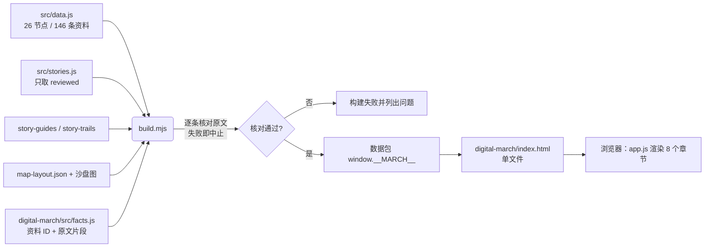

# 《数字长征沙盘》设计文档（赛道二 · AI 编程）

## 1. 目标与约束

| 目标 | 设计约束 |
| --- | --- |
| 让观众“走”一遍中央红军长征，并能随时核对出处 | 史实只取仓库知识库的已审核资料；页面不调用模型、不联网 |
| 手机、电脑都能流畅打开，现场演示不依赖网络 | 生成**单个 HTML 文件**（约 400 KB），图片、数据、脚本全部内联；不使用外部字体和 CDN（在国内网络下外部字体可能阻塞渲染） |
| 数据可复核、可回归 | 结构化事实带“资料 ID + 原文片段”，构建时逐条核对；检查脚本覆盖静态约束和浏览器走查 |

## 2. 目录结构

```
digital-march/
├── src/
│   ├── facts.js     结构化事实：日期锚点、四路红军、人数、会议、四渡赤水步骤、数字卡片、数字题、引文
│   ├── shell.html   页面骨架（章节标题与容器，HTML 语义结构）
│   ├── style.css    样式：设计变量（浅色 / 深色）、各章节组件、响应式
│   ├── app.js       交互脚本：章节模块 + 阅读框 + 行军卡
│   ├── vn-script.js 互动剧情剧本：人物、六幕台词、史料卡、选项与对应精神
│   └── vn-ui.js     互动剧情播放器（构建时插入 app.js）
├── assets/vn/       互动剧情图片（webp，构建时内联）
├── build.mjs        构建：读取知识库 → 核对事实 → 组装数据包 → 输出单文件
├── check.mjs        检查：资料核对、单文件约束、脚本解析、Playwright 浏览器走查
└── index.html       构建产物（提交到仓库，可直接打开）
```

复用的仓库文件（只读，不修改）：`src/data.js`（节点与资料）、`src/stories.js`（故事，含扩写稿）、`src/story-guides.js`（阅读引导）、`src/story-trails.js`（故事专题）、`src/map-layout.json`（沙盘坐标与路线）、`src/assets/longmarch-map.webp`（沙盘图）。

## 3. 数据流



### 3.1 事实核对规则（build.mjs）

| 事实类型 | 核对内容 |
| --- | --- |
| `dateAnchors`（26 条） | 每个节点都有锚点；`quote` 必须逐字出现在 `ref` 资料中；有 `end` 时结束日也必须出现在 `quote` 中 |
| `heroStats` / `armies` / `armyEvents` / `armySizes` | 每个数字所在片段出现在资料原文 |
| `meetings`（17 次） | `decision` 字段本身就是原文片段，页面原样显示 |
| `chishuiSteps` / `numberCards` | 片段出现在原文；卡片上的数字必须出现在片段中 |
| 互动剧情史料卡 | 卡片文字（以“……”分段）每一段都必须逐字出现在所引资料中；署名中的数字须在原文中 |
| 互动剧情虚构台词 | 台词、旁白、选项中不得出现阿拉伯数字；角色必须在人物表中；六种场景均需有选择，四种精神都要有选项对应；所用图片必须存在 |
| `numberQuestions`（12 题） | 片段出现在原文；正确答案出现在片段中；选项不重复且包含答案 |
| 故事事件段落 | 引用的资料 ID 必须存在 |

人物与站点的关系在构建时**自动计算**：人物取 `data.js` 中 ID 含 `_person_` 的资料，名字取首个逗号前的文字；某站任何一条资料的原文中出现该名字，就连一条线，并记录是哪几条资料（星河里展示的正是这些原文）。

### 3.2 数据包字段

`nodes`（含全部资料）、`mainOrder`（地图 23 站顺序）、`codaOrder`（直罗镇、会宁、将台堡）、`routeIndex`（每站在路线折线上的位置）、`map`（路线点、地名、沙盘图 data URI）、`stories`、`guides`、`trails`、`persons`、`refs`（被事实引用的资料原文与链接）、`facts`、`counts`。

## 4. 页面模块设计（app.js）

| 模块 | 关键实现 |
| --- | --- |
| 互动剧情 | 16:9 舞台（竖屏时舞台在上、对话框在下）；两张背景图交替淡入并缓慢推镜；人物剪影占左右两个位置，说话人提亮、其余变暗；史料卡、选项、章节标题、结尾为叠层；推进用 async/await 串起每一行，退出或跳章时用运行编号中止；进度、选择存 localStorage；环境声用 WebAudio 合成（白噪声、褐噪声经滤波和低频调制得到风、雨、水流，随机短脉冲得到柴火声，正弦和三角波铺底），每幕切换时交叉淡化 |
| 开篇“一笔长征” | 用 `map-layout.json` 的路线折线绘制 SVG，`stroke-dashoffset` 动画画出红线；站点圆点按路线长度比例延迟出现；“长征路上的今天”按月日比较锚点（含区间） |
| 行军沙盘（滚动叙事） | 左侧粘性舞台：沙盘图 + SVG 路线 + HTML 站点标记；`scroll` + `requestAnimationFrame` 判断当前卡片；切换时①按累计路线长度设置已走路线的 `dashoffset`，②计算镜头平移与缩放（夹在图片边界内），③站点标记用 `scale(1/缩放)` 保持大小不变，④线宽按缩放反算。支持点击跳站、方向键、自动行军（任何滚轮 / 触摸 / 按键即停止） |
| 四渡赤水 | 自定义坐标：横轴 = 西岸 / 东岸，纵轴 = 步骤先后；折线按累计长度逐段显示，五角星移动到当前步骤 |
| 甘特图 | 按月份建比例尺（1934.10—1936.11），条形和菱形都可聚焦、可回车；事件可跨多行用虚线连接 |
| 人数条形图 | 宽度按 8.6 万为 100% 等比例；窄条把数字放在条外，保证可读 |
| 会议纸带 | `scroll-snap` 横向纸带；小地图同步高亮站点，并把路线染红到该站 |
| 人物星河 | 站点按沙盘坐标排布；人物初始放在关联站点的重心附近，再做 360 步的简单力导向（人物互斥、避开站点、向重心回拉），结果确定、每次一致 |
| 故事阅读 | 原生 `<dialog>`；正文按句子分段；显示注释与全部出处；在当前专题内上一篇 / 下一篇 |
| 行军考场 | 每轮按固定题型顺序从题库随机组卷：数字题、会议题（避免把相近决定的会议同时作为选项）、人物题（遮住名字，排除在遮住文本中出现的干扰项）、排序题（4 站月份互不相同）、时间题 |
| 行军卡 | Canvas 绘制 1080×1500 图片：沙盘图 + 已走路线 + 统计 + 引文 + 可选署名；输出 PNG |

### 4.1 状态与隐私

只在 `localStorage` 中保存：走过的站点、读过的故事、答题最好成绩、主题偏好。读写都包在 `try/catch` 中，存储不可用时页面照常工作。署名只画在图片上，不保存、不上传。

## 5. 视觉设计

- **色彩**：灰布底色（红军军装的灰布）、墨色正文、领章红作强调、黄土色作次要强调；人物星河固定为夜空配色。深色模式整体换成夜行军配色，沙盘图降低亮度。全部颜色以 CSS 变量定义，同时适配系统深浅色和手动切换。
- **字体**：标题用楷体系（系统自带），正文用宋体系，日期和纸带用等宽字体，界面标签用系统黑体。只使用系统字体，保证离线和国内网络下的显示速度。
- **版式**：章节用“壹 贰 叁……”编号（章节确有先后），电报纸带和穿孔纸带呼应长征中的电台通信。
- **响应式**：≤820px 时沙盘置顶粘性、卡片从下方滚入；≤560px 时统计、卡片、选项改为单列 / 两列；宽图表（甘特图、星河）在自己的容器内横向滚动，页面本身不横向滚动。
- **无障碍**：可见焦点框；图表元素可用键盘操作；动态区域使用 `aria-live`；遵从“减少动态效果”。

## 6. 测试

`npm run test:march`（`digital-march/check.mjs`）：

1. 重新核对全部事实，并确认 `index.html` 与源文件一致；
2. 单文件约束：不出现外部 `script / link / img` 资源、CSS 无外部 `url()`；两段脚本可解析；文件小于 2 MB；
3. Playwright 在 1366×860 与 390×844 两种尺寸下：走完沙盘 26 站并核对电报纸带日期，走完四渡赤水（计数为 4），点击甘特图、会议纸带、星河人物、故事阅读，答完 10 题，生成带署名的行军卡；断言无脚本错误、无任何外部请求、页面无横向滚动。

## 7. 已知限制

- 路线、地形为示意；“出发后第几天”是按资料日期的推算。
- 人物与站点的连线基于名字在资料原文中出现，属于“资料共现”，不等于人物一定亲历该站全部事件（星河说明文字已写明）。
- 故事扩写稿沿用知识库现状（`reviewed: true`，并附原注释）；如知识库后续调整审核状态，重新构建即可同步。
